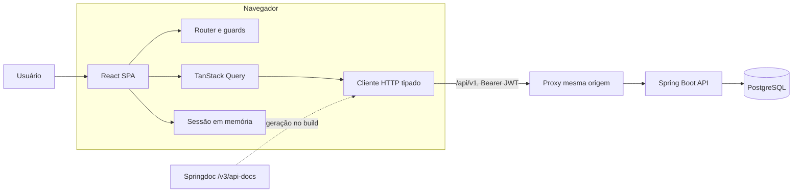

# Arquitetura do frontend

## 1. Objetivo e premissas

Esta proposta cobre o frontend web administrativo da API de gestão de frotas existente. A solução parte destas premissas:

- aplicação interna, responsiva e prioritariamente desktop;
- idioma inicial em português do Brasil;
- API REST versionada em `/api/v1`;
- autenticação stateless com JWT;
- autorização dinâmica por permissões, sempre validada novamente pelo backend;
- frontend e backend publicados na mesma origem;
- frontend mantido no diretório `frontend/` deste repositório, permitindo que o contrato OpenAPI evolua junto com a API.

Não entram no primeiro ciclo viagens, abastecimentos, manutenções ou relatórios, pois a API ainda não oferece esses recursos.

## 2. Decisões principais

| Tema | Decisão | Motivo |
|---|---|---|
| Aplicação | SPA com React e TypeScript | O produto atual é transacional e autenticado; SSR não traz benefício relevante |
| Build | Vite | Build simples e rápido para uma SPA independente do Spring |
| Rotas | TanStack Router | Rotas tipadas, layouts aninhados e proteção por permissão |
| Estado remoto | TanStack Query | Cache, invalidação e estados de carregamento/erro para a API |
| Estado local | React Context para sessão; URL para filtros | Evita um store global antes de existir necessidade real |
| Formulários | React Hook Form + Zod | Validação declarativa próxima às regras da API |
| Contrato HTTP | `openapi-typescript` + `openapi-fetch` | Tipos gerados a partir do Springdoc, sem duplicar DTOs manualmente |
| UI | Tailwind CSS + componentes acessíveis baseados em Radix | Consistência visual sem acoplar regras de negócio aos componentes |
| Testes | Vitest + Testing Library + MSW; Playwright no E2E | Pirâmide curta, com API simulada nos testes de interface |
| Entrega | arquivos estáticos em Nginx, com proxy de `/api` | Mesma origem, sem dependência de CORS em produção |

Redux não é necessário neste estágio. Quase todo o estado relevante vem do servidor e pertence ao cache do TanStack Query.

## 3. Visão de contêineres



Em desenvolvimento, o proxy é configurado no Vite. Em produção, o Nginx serve a SPA e encaminha `/api/*` para o Spring Boot. Assim, o navegador acessa apenas uma origem.

## 4. Módulos funcionais

O frontend deve espelhar capacidades do negócio, não controllers nem tabelas do banco.

| Módulo | Capacidades atuais da API | Permissões |
|---|---|---|
| Sessão | login, usuário atual, logout, alteração da própria senha | autenticado |
| Usuários | listar, detalhar, criar, editar, desativar, reativar e trocar senha | `USERS_READ`, `USERS_WRITE` |
| Setores | listar, detalhar, criar, editar e excluir | `SECTORS_READ`, `SECTORS_WRITE` |
| Perfis e permissões | consultar matriz e substituir permissões de um perfil | `PERMISSIONS_READ`, `PERMISSIONS_WRITE` |
| Veículos | listar, detalhar, criar, editar e desativar | `VEHICLES_READ`, `VEHICLES_WRITE` |
| Documentos de veículo | listar, detalhar e registrar nova versão | `VEHICLES_READ`, `VEHICLES_WRITE` |
| Motoristas | listar, detalhar, vincular usuário e desativar | `DRIVERS_READ`, `DRIVERS_WRITE` |
| CNHs | listar, detalhar e registrar nova versão | `DRIVERS_READ`, `DRIVERS_WRITE` |

Documentos e CNHs são sub-recursos de seus agregados. Eles não devem virar itens independentes na navegação principal.

## 5. Rotas e navegação

```text
/login                              pública
/
├── /inicio                         autenticado
├── /frota                          VEHICLES_READ
│   ├── /veiculos
│   └── /veiculos/:vehicleId
├── /motoristas                     DRIVERS_READ
│   └── /motoristas/:driverId
├── /administracao
│   ├── /usuarios                   USERS_READ
│   ├── /usuarios/:userId           USERS_READ
│   ├── /setores                    SECTORS_READ
│   └── /perfis-e-permissoes        PERMISSIONS_READ
└── /minha-conta/seguranca          autenticado
```

O menu é derivado das permissões da sessão. Um guard de rota impede navegação indevida, e cada ação (`Novo`, `Editar`, `Desativar`) usa a permissão de escrita correspondente. Isso melhora a experiência, mas não substitui os `@PreAuthorize` do backend.

`/inicio` deve começar como uma página de atalhos e pendências calculáveis com dados que o usuário pode ler. Não devem ser exibidos indicadores fictícios enquanto não houver endpoints agregados para dashboard.

## 6. Estrutura de código

```text
frontend/
├── public/
├── src/
│   ├── app/
│   │   ├── providers/              QueryClient, sessão, tema e erros globais
│   │   ├── router/                 árvore de rotas e guards
│   │   ├── layouts/                público, autenticado e administrativo
│   │   └── styles/
│   ├── features/
│   │   ├── auth/
│   │   ├── users/
│   │   ├── sectors/
│   │   ├── role-permissions/
│   │   ├── vehicles/
│   │   │   └── documents/
│   │   └── drivers/
│   │       └── licenses/
│   ├── shared/
│   │   ├── api/
│   │   │   ├── generated/          tipos OpenAPI; não editar manualmente
│   │   │   ├── client.ts           base URL, Authorization e Problem Details
│   │   │   └── query-keys.ts
│   │   ├── auth/                   tipos de sessão e verificação de permissão
│   │   ├── components/             componentes realmente reutilizáveis
│   │   ├── constants/              labels de enums da API
│   │   ├── errors/
│   │   ├── hooks/
│   │   └── lib/                    datas, placa e formatadores
│   ├── main.tsx
│   └── vite-env.d.ts
├── e2e/
├── package.json
├── tsconfig.json
└── vite.config.ts
```

Cada feature possui apenas o que usa:

```text
features/vehicles/
├── api/                            queries, mutations e invalidações
├── components/                     VehicleTable, VehicleForm etc.
├── pages/                          lista e detalhe
├── schemas/                        schemas Zod de entrada
└── index.ts                        API pública da feature
```

Features não importam arquivos internos de outras features. Quando algo é compartilhado de verdade, ele sobe para `shared/`; quando compõe uma página, a composição acontece em `app/` ou na página proprietária.

## 7. Estado e fluxo de dados

Há quatro categorias explícitas de estado:

1. **Servidor:** usuários, setores, veículos, documentos, motoristas, CNHs e permissões ficam no TanStack Query.
2. **Sessão:** token, usuário atual e permissões ficam em um `AuthProvider` pequeno.
3. **URL:** busca, filtros, ordenação, página e aba ativa ficam nos search params, permitindo recarregar ou compartilhar a tela.
4. **Formulário/UI efêmera:** campos, drawer aberto e confirmação ficam localmente no componente.

Exemplo de chaves de cache:

```ts
const queryKeys = {
  users: {
    all: ['users'] as const,
    detail: (id: string) => ['users', id] as const,
  },
  vehicles: {
    all: ['vehicles'] as const,
    detail: (id: string) => ['vehicles', id] as const,
    documents: (id: string) => ['vehicles', id, 'documents'] as const,
  },
};
```

Depois de uma mutation, invalida-se somente o agregado afetado. Não se copia uma lista do TanStack Query para Context ou Zustand.

## 8. Autenticação e autorização

### Fluxo de sessão atual

1. `POST /api/v1/auth/login` devolve `accessToken`, `tokenType` e `expiresIn`.
2. O cliente mantém o token em memória e o persiste em `sessionStorage` para suportar recarga da aba.
3. Na inicialização, se houver token, chama `GET /api/v1/auth/me` antes de liberar as rotas privadas.
4. O cliente envia `Authorization: Bearer <token>`.
5. Qualquer `401` limpa a sessão e redireciona para `/login`, preservando a rota de retorno.
6. `403` mostra acesso negado sem encerrar a sessão.
7. No logout, chama `POST /api/v1/auth/logout`; depois limpa a sessão mesmo se a rede falhar.

Não se deve usar `localStorage`, nem interpretar o conteúdo do JWT como fonte de verdade. A solução atual ainda é suscetível a XSS; por isso exige CSP restritiva, dependências controladas e ausência de HTML não sanitizado.

### Evolução recomendada

Para uma sessão mais robusta, a API deve futuramente oferecer refresh token rotativo em cookie `HttpOnly`, `Secure` e `SameSite`, mantendo o access token curto apenas em memória. Um BFF só se justifica se essa mudança não puder ser feita no backend.

### Permissões efetivas

O `AuthenticatedUser` já possui as permissões efetivas, porém `CurrentUserResponse` não as expõe. O contrato recomendado é:

```json
{
  "id": "uuid",
  "sectorId": "uuid",
  "name": "Nome",
  "email": "nome@exemplo.com",
  "role": "GESTOR_FROTA",
  "permissions": ["VEHICLES_READ", "VEHICLES_WRITE"]
}
```

Esse ajuste em `/auth/me` é necessário antes de implementar menu e guards dinâmicos. Não é seguro manter no frontend uma matriz fixa por perfil, pois a própria API permite alterar essa matriz.

## 9. Cliente HTTP e erros

O cliente deve normalizar o `ProblemDetail` retornado pela API:

```ts
type ApiProblem = {
  status: number;
  title: string;
  detail: string;
  instance?: string;
  code?: string;
  violations?: Array<{ field: string; message: string }>;
};
```

Tratamento por status:

- `400`: associa `violations` aos campos; se não houver campo, exibe erro do formulário;
- `401`: expira a sessão;
- `403`: tela ou aviso de acesso negado;
- `404`: estado de recurso não encontrado;
- `409`: mantém o formulário e mostra `detail` perto da ação;
- falha de rede/`5xx`: mensagem recuperável com opção de tentar novamente.

Mensagens do backend têm precedência. Labels locais traduzem enums técnicos, por exemplo `GESTOR_FROTA` para “Gestor de frota” e `INSPECTION` para “Inspeção”. Os valores enviados à API continuam sendo os enums originais.

Para `LocalDate`, o frontend deve manipular `YYYY-MM-DD` como data civil, sem converter diretamente com `new Date(value)`, evitando deslocamento de fuso. Campos `Instant` podem ser formatados com `Intl.DateTimeFormat('pt-BR')` no fuso local.

## 10. Padrão das telas

- Listagens: título, ação primária condicionada à permissão, busca/filtros na URL, tabela responsiva e estados de vazio/erro/carregamento.
- Cadastro e edição: mesma definição de formulário e schemas diferentes apenas quando a API divergir.
- Detalhe de veículo: resumo do veículo e seção “Documentos”, destacando `expired` e `expiringWithin30Days`.
- Detalhe de motorista: dados do usuário e seção “CNH”, com os mesmos estados de validade.
- Ações destrutivas: confirmação explícita, com “Desativar” no texto; a API normalmente faz desativação lógica, não exclusão física.
- Acessibilidade: navegação completa por teclado, foco devolvido após dialogs, labels visíveis e estados nunca comunicados apenas por cor.

## 11. Estratégia de testes

```text
Vitest puro
└── schemas, formatadores, política de permissões e query keys

Testing Library + MSW
└── formulários, listas, estados HTTP e guards

Playwright
└── login/logout, CRUD principal e matriz de permissões
```

Casos críticos de E2E:

- sessão expirada durante uma mutation;
- usuário com leitura, mas sem escrita;
- validação `400` associada aos campos;
- conflito `409` de e-mail, setor ou placa;
- documento/CNH vencido ou vencendo em 30 dias;
- usuário desativado e posterior reativação;
- gestor sem permissão de administração tentando acessar URL diretamente.

## 12. CI/CD e observabilidade

Pipeline mínimo:

1. lint e verificação de tipos;
2. testes unitários e de componentes;
3. geração dos tipos OpenAPI e verificação de diff;
4. build de produção;
5. E2E contra ambiente efêmero;
6. imagem do Nginx com os arquivos estáticos.

Erros inesperados devem passar por um Error Boundary e gerar logs sem token, senha ou corpo sensível. Um `request-id` devolvido pelo backend deve ser mostrado na tela de erro quando a API passar a fornecê-lo.

## 13. Ajustes recomendados na API

### Necessários para o primeiro frontend

1. Incluir `permissions` em `GET /api/v1/auth/me`.
2. Definir o proxy de mesma origem; se frontend e API ficarem em origens diferentes, configurar CORS explicitamente no Spring Security.
3. Documentar no OpenAPI os `ProblemDetail` e seus códigos para gerar um cliente completo.

### Necessários antes de crescer o volume ou o escopo

1. Paginação, busca, filtros e ordenação nas listagens hoje retornadas como `List`.
2. Expor versão ou ETag para concorrência otimista; as entidades já têm `@Version`, mas o cliente não recebe esse valor.
3. Definir reativação de veículos e motoristas, ou deixar claro que a desativação é irreversível.
4. Concluir o modelo de status operacional. `VehicleStatus`, `DriverStatus` e `UpdateVehicleStatus` existem no código, mas os recursos persistidos e os controllers usam apenas `active`.
5. Criar endpoints agregados somente quando houver requisitos reais de dashboard e relatórios.
6. Adotar refresh token rotativo se a duração e a experiência de sessão exigirem renovação silenciosa.

## 14. Plano de implementação

### Fase 1 — fundação

- scaffold React/TypeScript/Vite;
- design tokens e shell autenticado;
- cliente OpenAPI e tratamento de erros;
- sessão, login, logout, `/auth/me`, guards e testes base.

### Fase 2 — administração

- usuários e troca de senha;
- setores;
- perfis e permissões.

### Fase 3 — frota

- veículos e documentos;
- motoristas e CNHs;
- alertas de validade.

### Fase 4 — robustez

- E2E completo;
- paginação e filtros de servidor;
- observabilidade, CSP e hardening de autenticação;
- preparação para novos módulos de viagens e manutenção.

Essa sequência entrega primeiro a infraestrutura transversal e reduz retrabalho quando novos domínios forem adicionados à API.
